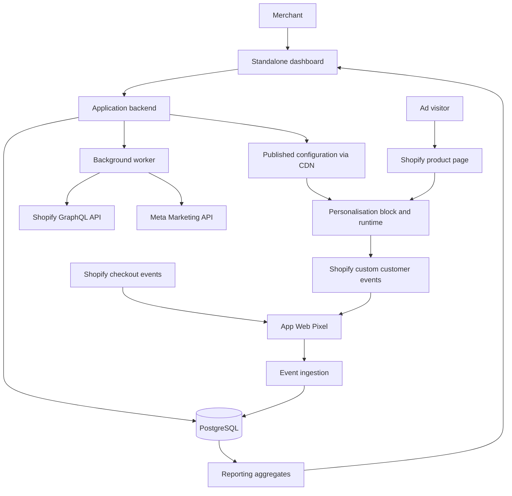

# Shopify ad-to-page personalisation: MVP build plan

Prepared 15 October 2026. Planning estimates below are engineering estimates, not platform approval commitments.

## 1. Product and first-release boundaries

Build a Shopify app with a standalone merchant dashboard. It connects to Shopify and Meta, imports existing ads, and tests different visible headlines and supporting descriptions on the same Shopify product page.

The central relationship is:

`Shopify store → selected Meta ads → experiment → original + content variants → measured outcomes`

One ad can have multiple page experiences. Multiple ads with the same destination can share an experiment. Each eligible visitor sees one assigned experience. The app never changes the underlying product name, catalog description, price, cart logic, or checkout.

### Explicit MVP scope

| Area | MVP decision |
|---|---|
| Customer | Individual Shopify brands; one store per workspace initially |
| Dashboard | Independent web app with custom design |
| Storefront | Shopify Online Store 2.0, Dawn first, then one pilot theme |
| Page | Existing product page; editable hero headline and short supporting copy |
| Placement | Merchant places an app block through the theme editor |
| Advertising | Meta website-destination ads; support simple, verified destination formats first |
| Variants | Original control plus up to two alternatives |
| Traffic | Fixed equal allocation; no automatic winner selection |
| Concurrency | One live experiment per store during the pilot |
| Ads per experiment | One or several explicitly selected ads leading to the same page |
| Copy | Manual editing; AI suggestions optional after the core works |
| Measurement | Consent-permitted, same-browser assignments and checkout events |
| Reporting | Assigned visitors, rendered exposures, funnel events, purchases, revenue, tracking health |

Defer arbitrary page builders, headless storefronts, separate-page redirects, universal DOM editors, images, prices, discounts, cross-device attribution, Meta campaign edits, Google Ads, agency accounts, and automated traffic optimisation.

The app block is a deliberate scope boundary. A block cannot automatically replace arbitrary theme elements everywhere. During onboarding, the merchant configures the default copy in the block and disables the corresponding original theme heading/text block where the theme supports that. The control is the new block with the original copy. Verify visual parity before starting a test. If the pilot theme cannot support that cleanly, build a narrow theme adapter or decline that theme until supported.

## 2. Merchant journey and screens

1. Create an account and workspace.
2. Connect Shopify and approve required access.
3. Open the theme editor, place the personalisation block, configure original copy, and save.
4. Connect Meta and choose an authorised ad account.
5. Import ads and select those sending traffic to the chosen product page.
6. Run a link check: confirm a stable ad identifier reaches the page.
7. Create alternatives; preview original/A/B on mobile and desktop.
8. Complete a test checkout and confirm exposure-to-purchase linkage.
9. Publish the experiment.
10. Review results and tracking health; pause or manually promote a variant.

### Screens to build

| Screen | Required capabilities |
|---|---|
| Setup | Shopify connection, block placement check, pixel health, Meta connection |
| Ads | Search/filter imported ads, destination, creative summary, last sync, compatibility |
| Experiment editor | Destination, selected ads, original/A/B copy, allocation, preview |
| Preflight | Missing identifiers, duplicate heading, consent state, test events, test purchase |
| Results | Cohort counts, outcomes, intervals, observation window, tracking coverage |
| Settings | Reconnect, pause store, members, data deletion, billing when launched |

Statuses: `draft → validating → ready → publishing → running → paused → ended`, with `publish_failed` and actionable errors. Do not label a database save as a successful storefront publish.

## 3. Recommended stack

Use TypeScript throughout the app and extension code. Keep one repository and one application backend rather than introducing microservices.

| Layer | Choice | Reason |
|---|---|---|
| Merchant frontend | Next.js, React, TypeScript | Custom dashboard, server routes, shared types |
| UI | Tailwind CSS and accessible component primitives | Flexible layout and predictable forms |
| Backend | Next.js server routes; service modules | OAuth callbacks, experiment APIs, event ingestion |
| Shopify client | Official Shopify API JavaScript library; GraphQL Admin API | Supported API client and authentication helpers |
| Meta client | Server-side HTTP client with typed adapters | Small integration surface; explicit pagination/retry control |
| Database | Managed PostgreSQL | Transactions, tenant isolation, events, aggregates |
| ORM | Prisma | Migrations and typed persistence |
| Background jobs | PostgreSQL-backed queue, such as pg-boss | Sync/retries without introducing Redis for the pilot |
| Storefront | Liquid app block plus small vanilla TypeScript bundle | Small runtime; no React on shoppers' pages |
| Customer events | Shopify Web Pixel extension | Standard funnel events plus custom experiment events |
| Hosting | Render web service, background worker, managed PostgreSQL | Straightforward deployment of app and worker |
| Public configuration | Cloudflare CDN in front of a public configuration route | Cache shared configuration, never visitor-specific responses |
| Merchant login | Managed identity provider, e.g. Clerk | Avoid building password recovery and account security |
| Monitoring | Sentry plus structured service logs | Trace failed connections, publishing, and ingestion |
| Tests | Vitest and Playwright | Rule/allocation tests and browser integration tests |
| CI | GitHub Actions | Type checking, tests, builds, deployment checks |

These are proposed implementation choices, not requirements imposed by Shopify. Pin compatible versions when scaffolding. [Next.js documentation](https://nextjs.org/docs), [Render workers](https://render.com/docs/background-workers).

Keep development, staging, and production separate, including Shopify app registrations, Meta configuration, databases, and secrets. Use test stores and test events in staging.

## 4. System architecture



The backend manages connections and publication. The browser chooses a variant from published configuration. The pixel collects permitted analytics. No Shopify Admin token, Meta token, database secret, or AI credential reaches the storefront.

## 5. Shopify integration

### Installation and authentication

Register a Shopify app and use the documented authorization code grant for the standalone dashboard. Use library helpers for callback verification, state/nonce validation, token exchange, and webhook verification. Store offline access credentials encrypted and implement the expiry/rotation behaviour of the selected token mode. Merchant dashboard login and Shopify installation are separate identities; attach a store only to a workspace whose authorised member initiated the verified flow.

Shopify documents this flow for apps running outside its admin. Use the GraphQL Admin API for new development. [Authentication](https://shopify.dev/docs/apps/build/authentication-authorization), [Shopify APIs](https://shopify.dev/docs/apps/build/apis).

### Access and resources

| Capability | Planned access |
|---|---|
| Product picker and page context | `read_products` |
| Create/configure app pixel | `write_pixels`, `read_customer_events` |
| Installation identity and app configuration | Installation queries; verify field-specific access when implementing |
| Read orders for server-side reconciliation | Deferred; request `read_orders` only if that feature is introduced |
| Edit theme source | Not required for block-based MVP |
| Customer email, address, phone | Not needed; do not request or collect |

Pixel activation uses `webPixelCreate`; Shopify documents the two pixel scopes above. Check protected customer data requirements for the actual event fields selected, even without names or emails. [Pixel creation](https://shopify.dev/docs/api/admin-graphql/latest/mutations/webPixelCreate).

### Theme extension

Ship a theme app extension containing:

- A personalisation block with default headline, default supporting text, typography controls, and a stable block identifier.
- A lightweight JavaScript asset that only operates on the app's own block.
- Optional app embed for small bootstrap/configuration needs if the prototype demonstrates a need; avoid loading duplicate runtimes.

Keep the initial page valid with JavaScript disabled. The default copy is server-rendered by Liquid. Merchant placement and theme support must be checked on the published theme, rather than assumed from installation. [Theme app extensions](https://shopify.dev/docs/apps/build/online-store/theme-app-extensions).

An app-data metafield can hold the public installation ID needed by the block. Keep private integration credentials in the backend. Shopify supports per-installation app-data metafields and cautions against storing credentials there. [Metafields](https://shopify.dev/docs/apps/build/metafields).

### Lifecycle and distribution

Implement uninstall handling, scope-change handling, and the mandatory privacy webhook topics: `customers/data_request`, `customers/redact`, and `shop/redact`. Verify webhook signatures, acknowledge quickly, enqueue work, and deduplicate deliveries. On uninstall, disable configuration serving and stop jobs immediately; execute deletion according to the applicable lifecycle and retention rules. [Privacy webhooks](https://shopify.dev/docs/apps/build/compliance/privacy-law-compliance).

Use separate development and production app registrations. Custom distribution is limited to one store or the same Plus organisation; one custom-distribution app is not a general multi-brand beta distribution route. Plan public distribution and review for unrelated merchants. For an initial single merchant, a separate custom pilot registration is possible. [Distribution](https://shopify.dev/docs/apps/launch/distribution).

For paid App Store launch, implement Shopify-provided billing. Current documentation recommends Shopify App Pricing for supported new public app plans. Do not assume an external dashboard permits bypassing Shopify billing. [Billing](https://shopify.dev/docs/apps/launch/billing).

## 6. Meta integration and existing ads

### Connection

Create a Meta developer app with Marketing API access and implement the appropriate business authorisation flow. The merchant authorises access and selects an ad account. Save the granted permissions, selected account, token metadata, and connection health; encrypt credentials.

Start with read-only access, targeting `ads_read`. Ask for additional permissions only when a tested endpoint needs them. Do not request `ads_management` merely to change Shopify page content. Meta's published Marketing API collection distinguishes access to your own accounts from Advanced Access for other businesses' accounts. Start access/review preparation during the first week; confirm verification and review requirements in the actual app dashboard. [Meta's Marketing API collection](https://www.postman.com/meta/facebook-marketing-api/documentation/0zr4mes/facebook-marketing-api-mapi?entity=request-31691153-75199fc3-314d-40ef-895b-3edbcf37ef06).

### Imported data

Import account identity/timezone/currency, campaigns, ad sets, ads, status, creative summaries, supported destination URLs, URL parameter configuration, and daily delivery metrics. Store platform IDs as strings. Preserve raw creative structure separately from your normalised summary.

Do not assume every creative has one headline, one image, and one URL. Mark catalog, carousel, flexible/dynamic creative, and other unsupported destination formats as unsupported or requiring manual verification. An ad ID does not identify the exact combination of creative assets a shopper saw.

Proposed sync policy: initial paginated import; incremental refresh every 30 minutes; manual refresh with a cooldown; daily insights refreshed on a rolling seven-day window to incorporate delayed changes. These are application defaults and must adapt to actual account limits. Retry throttles with backoff/jitter; isolate jobs per connection. Show last successful sync and reconnect actions.

If access expires, serving already-approved copy can continue from published configuration. Flag stale data and suspend new imports until reconnected. If an imported creative changes materially, require review before changing its live page copy.

### Existing ad identification

The storefront must receive a stable identifier in the incoming URL. Connecting an account imports metadata; it does not provide a per-visit identity lookup.

First support a literal per-ad parameter such as `lp_ad=123456`. Also support an existing `utm_content` or another parameter only after verifying that it uniquely contains the ad ID. A Meta dynamic parameter such as `lp_ad={{ad.id}}` is a candidate convenience template, but validate its current availability and real click expansion for the supported ad format before shipping it. Meta Help documentation was login-gated during this research, so that detail remains an integration spike rather than a verified dependency.

Example resolved visit:

`https://merchant.com/products/shoes?utm_source=meta&lp_ad=123456`

Match the ID against the connected store's imported ads and published page mapping. Never trust an arbitrary query parameter as authorisation. Treat `fbclid` as a click identifier, not as a decodable ad ID.

| Existing setup | Behaviour |
|---|---|
| Unique ad identifier already present | Reuse after real-click validation |
| Only campaign identifier present | Show that ad-level tracking requires setup; campaign-level support is deferred |
| No useful identifier | Merchant updates URL parameters in Ads Manager |
| Multiple destinations or stripped parameters | Fail preflight or require manual verification |

The MVP provides instructions and verifies a real click; it does not automatically modify existing ads. Review the consequences of edits on a test ad before recommending changes to live campaigns. A pasted synthetic test URL validates your parser, not Meta's actual click behaviour.

## 7. Data model and publication

Every tenant-owned record carries `workspace_id` and, where relevant, `shop_id`. Enforce these boundaries in queries and database constraints/policies.

| Entity | Important fields |
|---|---|
| Workspace / Member | Identity, role, account status |
| ShopInstallation | Shopify IDs/domain, public installation ID, encrypted token reference, scopes, lifecycle status |
| MetaConnection | Authorising identity, token reference, granted scopes, health, expiry metadata |
| AdAccount / Campaign / AdSet / Ad | External IDs, connection, creative snapshot/hash, destination, status, synced timestamp |
| PageTarget | Product ID, canonical path, locale, block ID, supported theme metadata |
| Experiment | Page, lifecycle status, start/end, attribution window, allocation seed, measurement policy |
| ExperimentAd | Experiment and selected Meta ad; mapping validation state |
| ExperimentRevision | Immutable copy, weights, targeting, control snapshot, schema version, checksum |
| PublishedConfig | Store, revision, public JSON, status, activated timestamp |
| Assignment | Anonymous visitor, experiment/revision, variant, entry ad, assigned timestamp |
| IdentityLink | Assignment/visitor ↔ Shopify pixel client ID, bounded by store |
| Event | Event ID/type/time, assignment, exposure ID, pixel client ID, order/checkout ID, numeric amounts/currency |
| Purchase | Unique order/checkout identity, matched assignment, amount, currency, observed timestamp |
| DailyAggregate | Experiment/revision/variant/ad/date/currency counts |
| AuditEntry | Actor, action, before/after references, timestamp |

Recommended constraints: one running experiment per store for the pilot; one assignment per experiment/visitor; unique pixel event per store/event ID; unique purchase per store/order ID when present; reject duplicate mappings that would create ambiguity.

### Publication transaction

Validate copy lengths, allowed plain-text fields, URL/page match, permissions, preflight health, and weights. Create an immutable revision and outbox job in one database transaction. A worker builds and activates public configuration, purges its CDN entry, checks the public response, and marks the revision live. Failed jobs are retryable without duplicate revisions.

Freeze text, allocation, and targeting during a test. A material edit starts a new experiment; historical results remain attached to the old revision. A promoted winner becomes a separately published experience with its test clearly ended.

## 8. How variants are served

### Configuration and caching

Serve a small, shared JSON configuration at `/public/stores/{publicInstallationId}/config.json`. It contains schema/revision IDs, allowed destination, selected ads, control/variants, allocation, expiry, and measurement policy. Everything in this JSON is public; include no secrets or sensitive account data.

Use an explicit Cloudflare cache rule; JSON is not automatically cached under every default configuration. Proposed live-config TTL: 30 seconds, no stale-on-error for active configuration, ETag support, and purge on publish/pause. Browser storage may cache configuration only until its explicit expiry. Store-specific keys prevent configuration mixing; never cache an assignment response globally. [Cloudflare caching behaviour](https://developers.cloudflare.com/cache/concepts/default-cache-behavior/).

This CDN fetch is the initial implementation. If measured performance is unacceptable, investigate a bounded Liquid-rendered public configuration snapshot. Do not assume Shopify metafield caching gives instant publish or pause propagation.

### Runtime algorithm

1. Render original copy from Liquid immediately.
2. Confirm supported page, block, locale, and consent state. Skip theme-editor and authorised preview sessions for measurement.
3. Read the ad ID and check it against the store/page mapping.
4. Fetch valid configuration with a strict deadline; proposed initial budget: 200 ms from runtime start. If it arrives late, leave the original in place for this page view.
5. After required consent permits it, get/create a cryptographically random first-party anonymous visitor ID. Use a 30-day lifetime as a proposed retention choice, subject to merchant/privacy configuration.
6. Reuse an existing assignment or compute `hash(visitor_id + experiment_id + seed)` into fixed allocation buckets. Persist the assignment; hash choice and bucket ranges must be identical across releases.
7. Record the assignment separately from rendering. For the control, use the same code path with unchanged copy.
8. Apply both text fields atomically using text operations, not untrusted HTML. Confirm the block is connected, visible, and displays the expected revision.
9. Emit a rendered-exposure event only after successful application. Record failures separately; never label a planned variant as displayed.
10. Restore/default safely if the block is replaced or invalidated by theme behaviour. Do not repeatedly overwrite unrelated theme content.

Assignment remains stable within an experiment even if a visitor later clicks another selected ad. Store the first eligible ad as the experiment-entry ad. Display the experiment only on its target page. Organic visitors without an eligible assignment or ad stay on the default experience.

No AI call, Meta API request, or per-visitor Shopify Admin call runs in this flow. Client-side replacement can produce a brief copy change; do not promise zero flicker. Never hide the whole page. Reserve appropriate block space and test long copy on mobile. Shopify recommends minimising render-blocking code and reserving space for injected content. [Theme performance](https://shopify.dev/docs/storefronts/themes/best-practices/performance).

### Pause and fallback semantics

Pause stops new experiment rendering when the runtime sees the inactive configuration. Set a proposed acceptance target of 60 seconds for fresh page loads after pause; verify it against real caches. Existing open tabs need not update immediately, and already-assigned cohorts remain in reporting through the attribution window. An expired/offline configuration must default safely and must not create a treatment exposure.

## 9. Tracking and purchase attribution

### Two distinct execution environments

The theme block changes page content. The app pixel runs in Shopify's sandbox and receives permitted customer events. Do not use the pixel as a DOM editor.

The theme runtime publishes namespaced custom events through `Shopify.analytics.publish`. The app pixel subscribes and forwards allowlisted fields to ingestion. Shopify supports custom events from theme extensions and warns that these events can be forged by clients; treat them accordingly. [Custom customer events](https://shopify.dev/docs/api/web-pixels-api/emitting-data).

| Event | Purpose |
|---|---|
| `app:experiment_assigned` | Visitor cohort, chosen variant, revision, entry ad |
| `app:variant_rendered` | Confirmed rendering, exposure ID, matching assignment |
| `app:variant_failed` | Failure reason and planned variant; no content/PII dump |
| `product_added_to_cart` | Standard funnel event |
| `checkout_started` | Standard funnel event |
| `checkout_completed` | Purchase observation and value |

Subscribe to standard events rather than fabricating them. [Shopify standard events](https://shopify.dev/docs/api/web-pixels-api/standard-events).

### Consent policy

Configure pixel privacy requirements accurately. For the MVP, enter experiments only when the required analytics and personalisation/marketing permissions are available under the merchant's settings. Use Shopify's allowed-processing methods rather than interpreting raw consent flags yourself. If privacy state is unavailable, fall back to original content without experiment storage or analytics. If consent arrives late, begin on a subsequent eligible page load; do not invent exposure data for the earlier view. Stop collection and clear app-owned identifiers as required when consent is withdrawn. This policy intentionally narrows the measurable audience. [Customer Privacy API](https://shopify.dev/docs/api/customer-privacy).

### Identity bridge: prove this first

1. Runtime creates assignment ID and exposure ID after permitted assignment/rendering.
2. It publishes these values with the experiment/revision/variant, entry ad ID, and page ID.
3. The pixel forwards the custom event with its Shopify event ID and `clientId`.
4. Backend saves the assignment-to-pixel-client link scoped to the store.
5. At checkout, the pixel sends standard events containing Shopify's client ID and permitted checkout/order identifiers.
6. Backend joins to the existing experiment assignment, subject to the fixed attribution window.

Shopify exposes a client ID on checkout events, but its reliable continuity across your supported storefront/checkout paths is an engineering acceptance test, not a guarantee to assume. Do not read undocumented Shopify cookies. Pixel browser storage uses Shopify's asynchronous APIs, and should not be treated as automatically shared across domains. [Checkout event reference](https://shopify.dev/docs/api/web-pixels-api/standard-events/checkout_completed), [Pixel browser APIs](https://shopify.dev/docs/api/web-pixels-api/standard-api/browser).

Handle pixel subscription timing: test events emitted before/after pixel initialisation and after consent. Bounded republishing can reuse the same custom event ID, with server deduplication. Do not reconstruct a rendered exposure from a later checkout alone. Process out-of-order events and retain unmatched purchases briefly for retrying joins.

If the bridge fails on a checkout path, label that path unsupported for purchase attribution or build a tested cart/checkout association mechanism before claiming coverage. Cart attributes are a possible follow-up, not an automatic guarantee for accelerated checkout. A first-party browser cookie alone does not solve checkout-domain changes.

### Attribution policy

- Randomisation unit: anonymous browser visitor, scoped to store and experiment.
- One active experiment per store prevents overlapping pilot cohorts.
- Window: seven days from first eligible assignment; freeze this policy before launch.
- Attribute only purchases after assignment and within the window, including purchases after the test stops enrolling visitors.
- Primary conversion: at least one observed purchase per assigned visitor.
- Revenue: sum deduplicated observed checkout merchandise subtotal after discounts, by currency. Confirm field semantics in the pinned API version and label the metric precisely.
- No silent currency conversion or sums across currencies.
- Pixel revenue is observed checkout revenue, not verified net paid revenue; refunds/cancellations and authoritative reconciliation are deferred.
- Unmatched purchases remain unmatched; do not guess from time proximity, email, or IP address.
- Cross-device purchases and some blocked/consent-denied visits will be unmeasurable.

`checkout_completed` can be missed if its triggering page never loads. A later version can add order webhooks, validated assignment metadata, and refund handling, but webhooks alone cannot recover a missing experiment assignment. [Checkout event behaviour](https://shopify.dev/docs/api/web-pixels-api/standard-events/checkout_completed).

### Ingestion reliability

Validate payload schemas, tenant/experiment relationships, timestamps, active revisions, lengths, and currency/amount formats. Strip unneeded checkout fields before sending. Use a unique app event ID for custom events and Shopify event IDs for standard events. Deduplicate purchases by store/order ID where available, otherwise a tested checkout identifier; reject ambiguous cases rather than count twice.

Write accepted events durably before acknowledging; update aggregates asynchronously and rebuild them from retained events. Rate-limit public endpoints, enforce payload limits, and exclude known preview/test traffic. Store public ingestion keys are not secrets; CORS and domain allowlists are not cryptographic event authentication. Mark browser-derived purchase data accordingly.

Proposed retention: 90 days for raw events and identity links, longer-lived non-identifying aggregates only where deletion obligations permit. Document actual retention and test deletion jobs.

## 10. Results and experiment decisions

Show the primary result by randomised assignment, including assigned visitors whose treatment failed to render. Otherwise a slower or broken variant can look better by excluding failures. Also show a secondary exposed-only diagnostic and per-variant render success, so implementation problems are visible.

The measurable cohort consists of permitted visitors with a received assignment event. Missing assignment events cannot be counted; disclose that instrumentation limitation and monitor event loss. Apply identical collection logic to control and treatment.

| Metric | Definition |
|---|---|
| Assigned visitors | Unique received assignments in the cohort |
| Render success | Assigned visitors with a matching confirmed exposure / assigned visitors |
| Purchase conversion | Assigned visitors with ≥1 attributed observed purchase / assigned visitors |
| Revenue per visitor | Attributed observed subtotal / assigned visitors, split by currency |
| Cart/checkout rate | Assigned visitors with the relevant standard event / assigned visitors |
| Pixel link coverage | Assigned visitors linked to a pixel client ID / assigned visitors |

Track config failures and missing identifiers operationally, subject to privacy rules; these are not automatically visible as complete visitor counts. Report ad-click totals from Meta separately from measured landing visitors. Clicks, visits, and assigned visitors use different definitions and will not reconcile exactly.

Show uncertainty intervals and “insufficient evidence” until the predeclared sample plan is met. Pick baseline conversion, minimum detectable effect, confidence/power, and multiple-comparison method before launching. A control plus two alternatives requires adjustment for multiple comparisons. Do not pick a winner from repeated daily significance checks. Let the seven-day observation window mature before final reporting.

Pool results only for ads explicitly sharing the same experiment and randomise within each ad's traffic through the same hash rule. Per-ad breakdowns are diagnostic and may be underpowered. Meta spend belongs to the ad; do not present exact variant ROAS by dividing that spend according to observed visitor share.

## 11. Service interfaces and repository structure

Proposed server routes:

| Interface | Purpose |
|---|---|
| `/api/shopify/install`, `/callback` | Shopify connection |
| `/api/meta/connect`, `/callback` | Meta connection |
| `/api/ads`, `/api/ads/sync` | Imported ads and sync requests |
| `/api/experiments` | Draft management |
| `/api/experiments/:id/validate` | Preflight checks |
| `/api/experiments/:id/publish`, `/pause` | Versioned lifecycle actions |
| `/public/stores/:publicId/config.json` | Public shared configuration |
| `/api/events` | Validated public pixel ingestion |
| `/api/reports/:experimentId` | Tenant-protected results |
| `/webhooks/shopify` | Verified lifecycle/compliance deliveries |

Merchant mutations require authenticated workspace membership and CSRF protection where applicable. OAuth callbacks verify provider signatures/state and installation context. Public routes use separate validation and rate limits.

```text
apps/web/                 dashboard, API routes, merchant sessions
apps/worker/              sync, publication, aggregation, deletion jobs
extensions/personalise/   Liquid block and storefront TypeScript
extensions/events/        Shopify Web Pixel extension
packages/domain/         assignment, mapping, lifecycle, report rules
packages/integrations/   Shopify and Meta adapters
packages/contracts/     schemas shared across public boundaries
packages/database/      migrations and persistence
tests/e2e/               browser and integration scenarios
```

## 12. Build sequence and estimates

Estimate: 8–10 engineering weeks for one experienced full-stack engineer with part-time design and QA, assuming a narrow supported theme set. Add capacity or time for unfamiliarity with Shopify/Meta. Platform reviews, merchant setup, and statistical sample collection have independent timelines.

| Milestone | Indicative timing | Deliverable / exit condition |
|---|---|---|
| 0. Technical proof | Week 1 | Real ad click preserves ID; same product URL shows original/A/B; purchase joins to exposure on supported checkout paths |
| 1. Foundation | Week 2 | Auth, workspace isolation, database, CI, staging, Shopify install/uninstall, encrypted credentials |
| 2. Storefront | Weeks 3–4 | Block placement, consent-aware assignment, config publication/cache expiry, fallback, preview and pause |
| 3. Meta and editor | Week 5 | Merchant authorisation, ad import, compatibility classification, link preflight, immutable drafts/revisions |
| 4. Measurement | Weeks 6–7 | Pixel custom/standard events, retries/dedup, identity joins, purchase report, tracking diagnostics |
| 5. Pilot hardening | Week 8 | Pilot theme QA, performance comparison, privacy lifecycle tests, billing if charging |
| 6. Launch preparation | Weeks 9–10 | Review assets, documentation, reconnect support, production readiness, pilot fixes |

Start Shopify distribution planning and Meta access review in Week 1. Use a manual ad ID to unblock core engineering if Meta approval is pending; that is a development fallback, not a substitute for the promised production integration.

### First week's concrete tasks

1. Register development apps, create a Shopify dev store, choose one existing website-destination test ad, and agree on a supported theme.
2. Build the minimal Liquid block and original/A/B runtime with hard-coded configuration.
3. Validate the real ad identifier and repeatable visitor assignment.
4. Publish a custom exposure event; link it through the pixel to an ordinary test checkout.
5. Test at least one accelerated checkout path, consent decline/accept, Safari, and Meta's in-app browser where feasible.
6. Measure copy change/latency and document which theme and checkout paths passed.
7. Decide whether to proceed with this serving/tracking design before building the full dashboard.

## 13. Verification and launch acceptance

| Area | Required checks |
|---|---|
| Installation | Valid install, replayed/invalid callback, scope change, uninstall, reinstall |
| Tenant isolation | Another workspace cannot read credentials, ads, experiments, or reports |
| Meta | Pagination, revoked token, missing permissions, throttle, changed creative, unsupported formats |
| Mapping | Wrong ad, wrong store/page, stripped parameter, organic visit, duplicate mappings |
| Assignment | Stable reload/revisit, correct allocation boundaries, same behaviour for control, no reassignment from another selected ad |
| Rendering | JS disabled, long copy, missing block, duplicate heading, theme section reload, runtime failure |
| Publishing | Failed job, duplicate retry, cache purge failure, expiry, pause, rollback, concurrent edit |
| Consent | Unknown/denied/allowed states, late consent, withdrawal, no tracking before permissions |
| Tracking | Pixel starts late, duplicate/out-of-order events, failed delivery, refresh of thank-you page |
| Checkout | Standard cart checkout, buy-now/accelerated paths claimed as supported, post-purchase offer flow |
| Reports | Synthetic known cohort, exact dedup, observation window, currency separation, immature cohorts |
| Privacy | Valid/invalid webhook signatures, data export/deletion, uninstall cleanup, no PII/token logs |

Proposed engineering targets, to measure rather than advertise in advance:

- Storefront JavaScript ≤15 KB gzipped, excluding Shopify's own pixel infrastructure.
- Only fetch configuration on supported target pages; no calls to Meta/AI from shoppers' browsers.
- Default content remains usable through config outages and script errors.
- No measurable layout shift caused by the block in the tested mobile layouts; investigate any regression.
- Test p75 LCP/INP against the same page without the app, including throttled mobile conditions.
- Fresh page loads observe pause within the agreed 60-second target in supported environments.
- All scripted purchases in supported, consent-permitted QA paths join correctly and deduplicate exactly once.
- Report updates within five minutes of an accepted event under pilot load.
- Alerts for failed publishes, sync failures, ingestion failures, and queue backlog.

Do not expand checkout/theme support claims when only the standard happy path has passed.

## 14. Pilot and launch decisions

Recruit 2–3 brands that already send paid traffic to product pages and can implement tracking parameters. Start each store with one product page and one ad or a small same-destination ad group. Reuse the same control/A/B across that selected group.

Measure onboarding completion time, how many existing ads have usable identifiers, block-placement success, render reliability, identity-link coverage, merchant understanding of results, and willingness to run another experiment. Conversion uplift is a hypothesis, not a launch requirement or promise; a reliable, interpretable experiment can find no uplift.

Recurring cost categories: web service, worker, database/backups, CDN traffic, identity provider, error monitoring, and optional copy generation. Size costs from measured pilot event volume and current provider prices before choosing paid tiers. Avoid a warehouse, Redis, or a separate AI service until the workload justifies them.

### Required decisions before implementation

1. Confirm product pages and Dawn as the first supported surface.
2. Accept manual tracking-parameter setup for existing ads in the MVP.
3. Confirm one live experiment per store during the pilot.
4. Confirm original plus up to two text variants with fixed splits.
5. Select one pilot merchant and an accessible test ad account.
6. Choose public app distribution timing and whether the pilot is free.

Recommended first engineering ticket: prove real ad identification, text assignment, and exposure-to-purchase linkage in one store. The dashboard build follows once those three parts work together.
